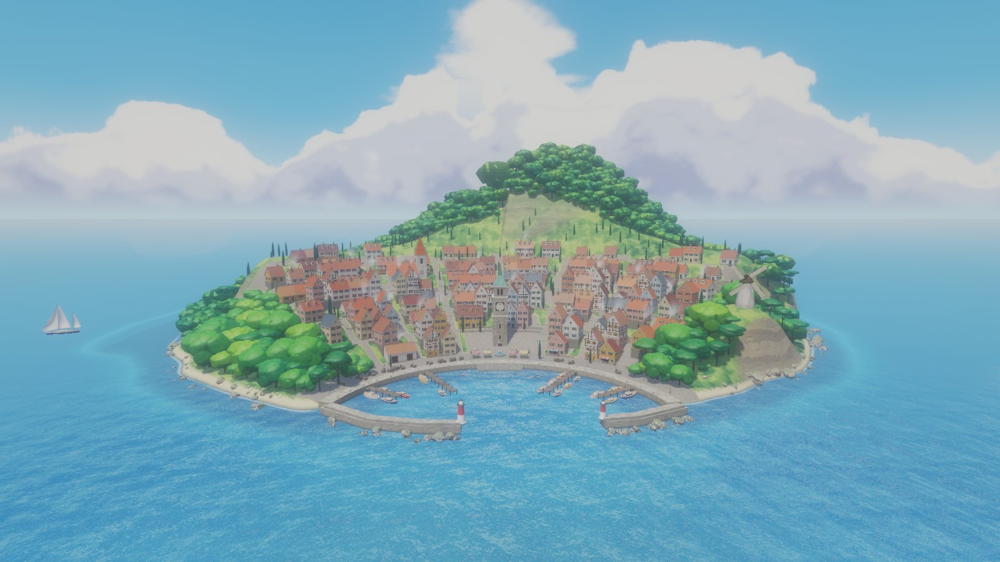
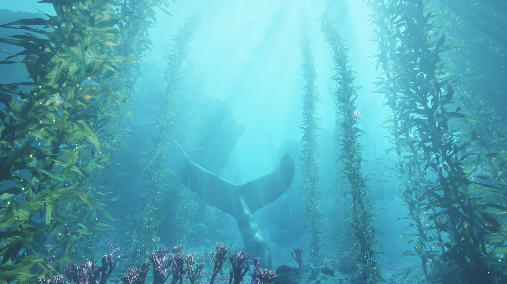
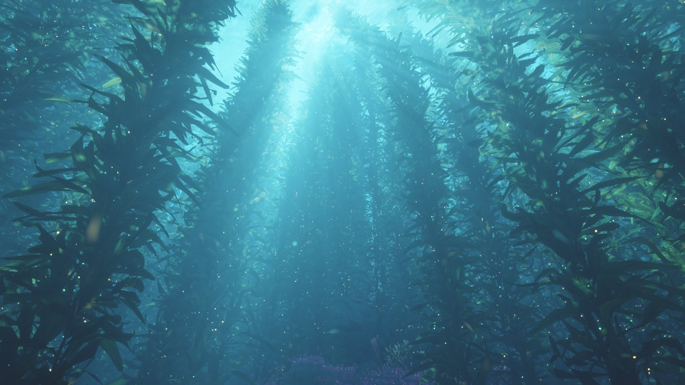
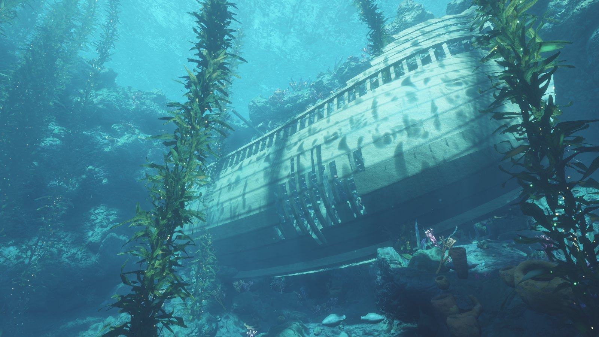
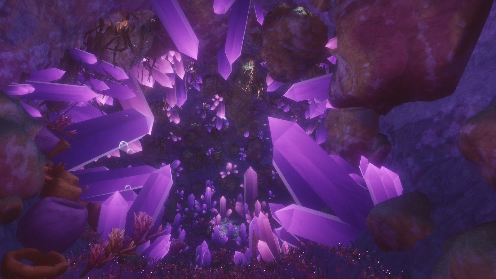
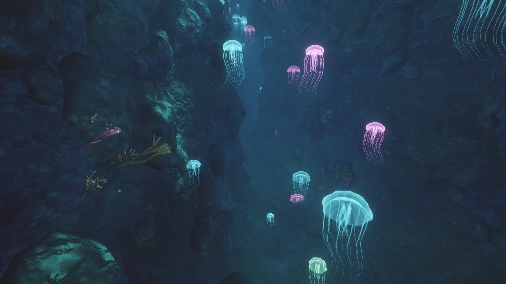
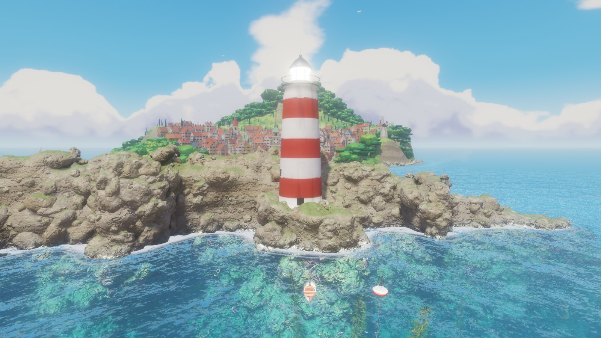
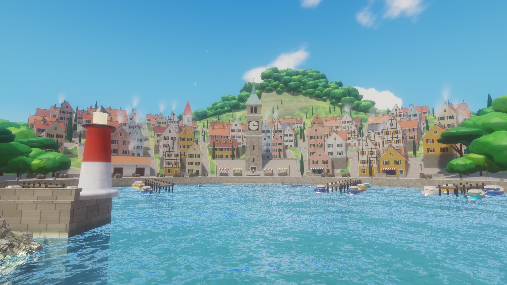
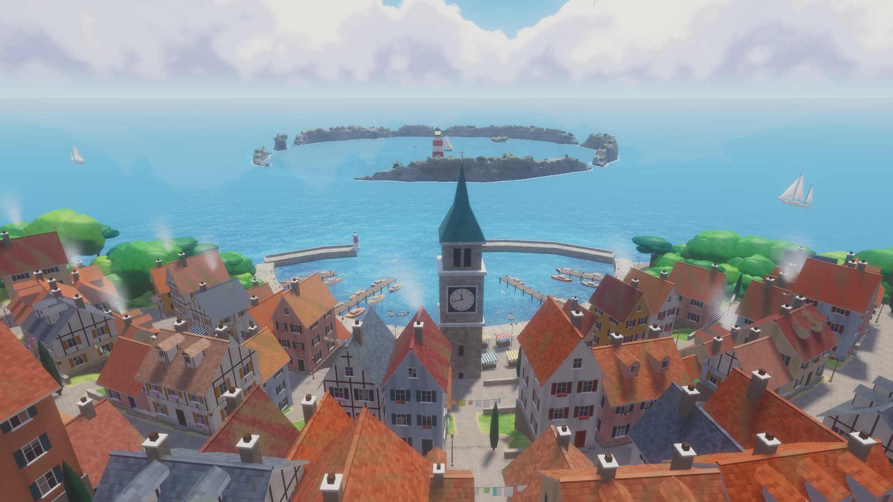

<div align="center">

# Lantern Reef

**A procedural sea in one HTML file.**<br>
Swim through a coral atoll, break the surface, and fly over a harbor town painted in the colours of a summer afternoon.

[**Open the live demo**](https://leehongji.github.io/lantern-reef/) · [How it works](#how-it-works) · [Build it yourself](#build)



`WebGPU` · `WGSL` · `Web Audio` · no libraries · no textures · no models · no sound files · 229 kB (74 kB gzipped)

</div>

---

Everything you see and hear is computed when the page loads: the rock, up to two million kelp blades, 4,700 fish,
about 145 houses, about 2,300 trees, the sky, the water and the soundscape. Nothing is
downloaded but the page itself.

## Ten places

| | |
|:---:|:---:|
|  |  |
| **1 · Monolith Basin** — a whale's tail in stone, in a kelp clearing | **2 · Kelp Cathedral** — forty metres of forest |
|  |  |
| **3 · Wreck Gorge** — a galleon against the wall | **5 · Amethyst Grotto** — crystals under a skylight |
|  |  |
| **6 · The Rift** — where the glow lives | **8 · Lantern Rock** — the light on the rim |
|  |  |
| **9 · Port Amaro** — the harbor and its clock | **0 · The Overlook** — roofs, the bay and the reef beyond |

Also **4 · Arch Row**, three rock gates and a drowned colonnade, and **7 · The Anchorage**, a ketch riding at
anchor above the reef.

## What is in it

**Below the surface.** Canyons, overhangs, arches, tunnels and a deep rift carved from a voxel field. Swaying
giant kelp with floats and drifting glints, ribbon grasses, magenta ground cover, sponges, branching coral, sea
fans, starfish and urchins. A wrecked galleon, a stone whale fluke, a drowned colonnade, a grotto of glowing
amethyst. Fish schools in four liveries, manta rays, sea turtles, jellyfish in the rift and a humpback cruising
under the swell. Shadowed god rays, caustics that soften with depth, Snell's window, marine snow and depth fog.

**Above the surface.** A summer sky with a bank of cumulus on the horizon. Open water with Fresnel reflection,
turquoise shallows, surf along the shore. A lighthouse on its islet, an anchored ketch whose chain runs down to
the seabed, a dinghy and a bell buoy, sails out at sea, gulls.

**The island.** Port Amaro stands on streets that ring its bay and climb the hill like the seats of a theatre:
plaster houses with shutters and flower boxes, a clock tower whose hands move, a church, a market square with
stalls and a fountain, washing lines and chimney smoke. Below it a stone quay with steps to the water, two
breakwaters, jetties and fishing boats in every colour. Behind it a wooded hill with one great tree, a windmill
whose sails turn, farmland in hedged patches, cypress-lined tracks, a beach and northern cliffs.

**Sound, synthesized live.** Under water: a low rumble, a wash that follows the swell, a rush when you swim
fast, a slow drone, bubbles near vents, chimes in the grotto and whale song that comes from where the whale
is. In the air: wind, lapping water, gulls, the buoy's bell, creaking rigging, cicadas, halyards tapping in
the harbor and the clock tower striking. Breaking the surface splashes and swaps one world for the other.

## Controls

| Key | Action |
|---|---|
| Mouse | Look (click to capture the pointer) |
| `W` `A` `S` `D` | Swim or fly |
| `E` / `Q` | Up / down |
| `Shift` | Faster |
| `1`–`9`, `0` | Jump to a viewpoint |
| `M` | Mute |
| `H` | Frame rate and render size |
| `Esc` | Menu, with Low / Medium / High detail |

On a touch screen: hold to move forward, slide to steer, add a second finger to go faster.
`?lv=0`, `?lv=1` or `?lv=2` in the address forces High, Medium or Low.

## Requirements

A browser with WebGPU, such as a current Chrome or Edge on the desktop. The scene picks
a detail level from the GPU and memory, then scales its render size and draw distance to hold 60 fps. If a load
ever crashes the tab, the next visit starts one level lower.

It has been tested in Chrome on an Apple-silicon Mac. Other browsers and GPUs should work but have not been
checked; reports are welcome.

## How it works

The world is built once, then rasterized every frame.

1. **Rock from a density field.** A compute shader fills a 480 × 104 × 480 voxel field (0.75 m cells) from a
   short list of primitives — mesas, ring arches, tunnels, caves, rifts — warped by noise, broken by Worley cells
   and layered with bedding. Surface nets turn it into 1.75 million triangles. Anything not connected to the
   seabed is removed first, so no specks float.
2. **Dress every surface.** Kelp, grass, sponges, coral and rocks are placed by sampling the terrain and
   filtering on slope, height, zone and distance from the camera paths. A kelp blade is one 36-byte instance;
   its bend, twist, ruffle and sway are all computed in the vertex shader.
3. **The island is a height field** with the town laid out on level arcs round the bay. Houses are six
   procedural variants whose parts (plaster, tile, glass, shutters, trim, flower boxes) are tagged per vertex
   and coloured in the shader from a small palette.
4. **Baked light.** Two 4096 sun shadow maps (reef and island) and a half-resolution 3D texture of openness and
   skylight give ambient occlusion, dark canyon floors and moody kelp interiors at the cost of a texture fetch.
5. **One water texture.** A small texture redrawn every frame holds the caustic pattern and the wave slopes;
   caustics, the surface normal and the light shafts all read it, so they agree.
6. **Fog in closed form.** Light scattered into a ray through water whose brightness falls with depth is
   integrated analytically, per colour channel, so distance turns everything from cyan to deep blue.
7. **A painted look above water.** Shade is tinted blue-violet, never grey; trees are massed volumes lit in
   three flat tones; clouds have level bases and heaped crowns; roofs come in a family of terracottas.
8. **Finish.** 4× MSAA into an HDR target with reverse-Z, half-resolution god rays with depth-aware blur and
   upsample, a six-level bloom, a filmic tone curve and dithering.
9. **Hold the frame rate.** Draws are culled in grid cells with levels of detail. GPU timestamps drive a
   controller that trades pixels first, then draw distance, and remembers the result for the next visit.

The design notes, the lessons learned and the full list of pitfalls are in [CLAUDE.md](CLAUDE.md).

## Build

`index.html` is the whole app and is committed, so you can simply open it through any static server.
To change it, edit `src/` and rebuild. The build has no dependencies.

```bash
node build.mjs          # index.html
node build.mjs --dev    # dev.html: adds a fly-through (F), a benchmark (B) and test hooks
python3 -m http.server 8792   # then open http://localhost:8792
```

```
src/00-quality.js     detail level and saved settings
src/10-math.js        noise, quaternions, surface nets, mesh builder
src/15-world.js       reef layout, viewpoints and everything placed under water
src/16-meshes.js      rocks, coral, ships, lighthouse, animals
src/17-land.js        the island: ground, town, harbor, trees, farmland
src/20-wgsl-bake.js   density field, detail texture, water texture, bloom
src/21-wgsl-scene.js  terrain, materials, plants, animals, sky, sea surface, particles
src/22-wgsl-post.js   light shafts and the final composite
src/40-main.js        device, render loop, camera, collision, input, menu
src/50-audio.js       the soundscape
src/60-dev.js         fly-through, benchmark and test hooks (dev.html only)
template.html         page, menu and styles
```

The scripts in `.test/` drive `dev.html` in headless Chrome with the real GPU: viewpoint renders, per-view GPU
time, a 60-second fly-through benchmark and an input test. They need Playwright; set `PLAYWRIGHT_FROM` to a
folder where it is installed if it is not installed here.

## Credits

The rendering approach — density field and surface nets, instanced leaves, baked shadow and skylight, analytic
fog — and several helper functions are adapted from
[Abyssal Garden](https://github.com/Noniv/abyssal-garden) by Maksymilian Dendura (MIT). The world, the island
and town, the above-water scene, the extra creatures and the audio are this project's own.

## License

[MIT](LICENSE).
